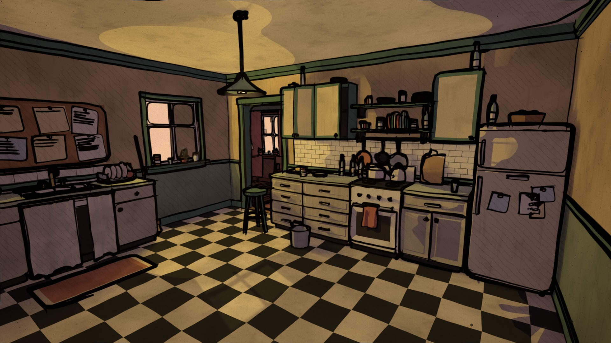
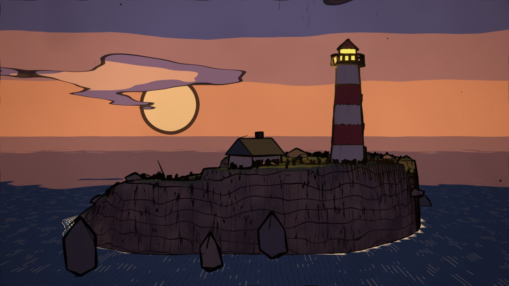
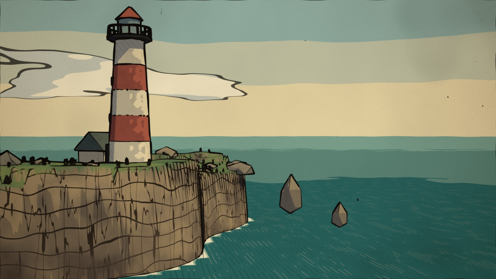
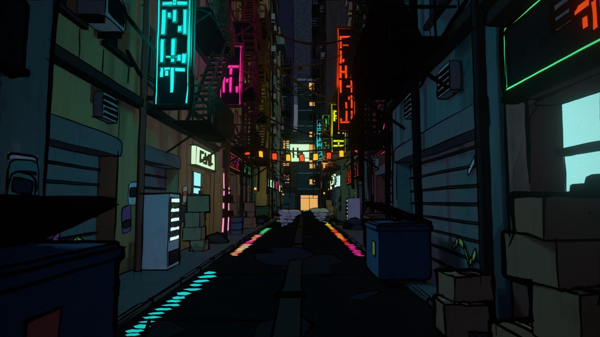
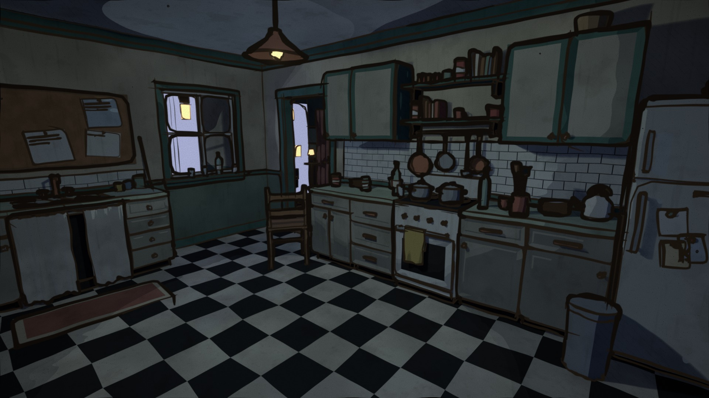
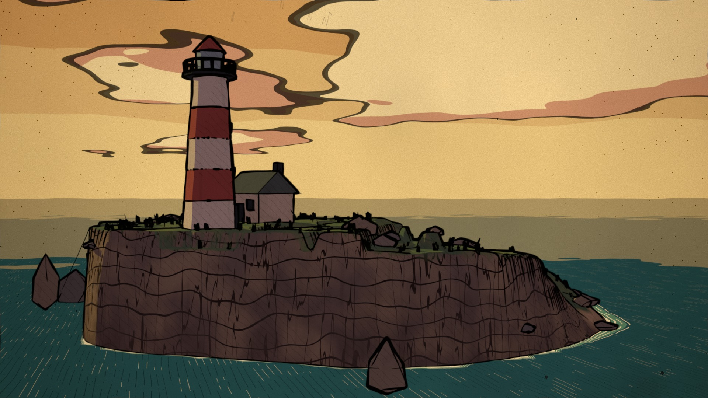
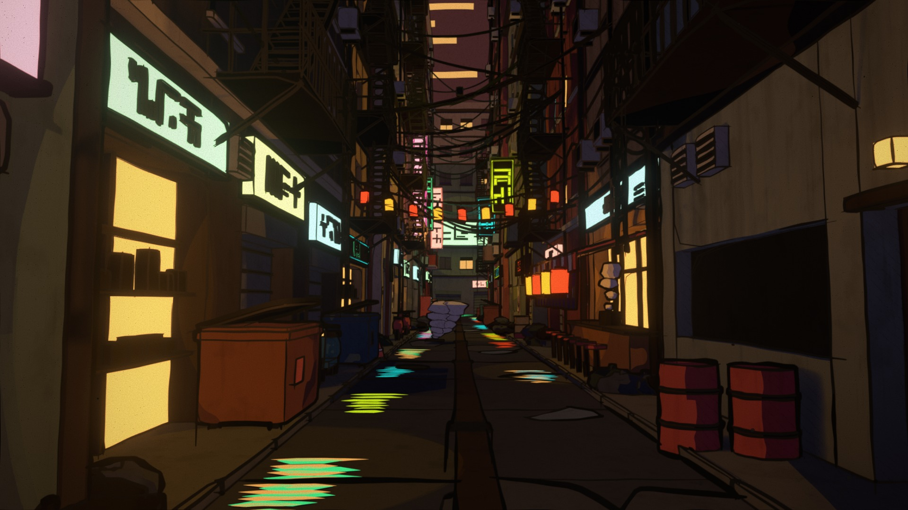

# Procedural Worlds

A Blender 5.2 add-on (pure Python / `bpy`, no external assets) that generates a complete scene from a seed (geometry, materials, lights, camera) and renders it as a **hand-inked graphic-novel panel**: wobbly brush outlines, flat cel shading, hatching, grime and paper grain.



## Gallery

| | |
|---|---|
|  |  |
|  |  |
|  |  |

Seed × mood contact sheets (seeds 1 / 7 / 42 × day, golden hour, dusk, night):
[kitchen](renders/sheets/kitchen_sheet.jpg) · [island](renders/sheets/coastal_island_sheet.jpg) · [alley](renders/sheets/cyberpunk_alley_sheet.jpg).
A short fly-through with "boiling" lines: [renders/flythrough_coastal_island_42_dusk.mp4](renders/flythrough_coastal_island_42_dusk.mp4).

## Features
- **Three scene generators**, each deterministic per seed, in four moods (day, golden hour, dusk, night):
  - **Coastal island:** cliffs with inked strata, a lighthouse and cottage, sea stacks, grass placed with Geometry Nodes, and an ink-drawn sea with foam rings and no visible horizon edge.
  - **Kitchen interior:** a lived-in room with a checker floor, cabinets, a cork board, pans and clutter, and a hallway beyond the door.
  - **Cyberpunk alley:** fire escapes, neon blade signs, sagging cables, lanterns, and neon streaks reflected in a wet road.
- **Ink style module (`ink.py`)** that any scene gets automatically:
  - Grease Pencil Line Art outlines: heavy silhouettes, thin inner lines, noise, tapered ends and overshoot.
  - Cel shading through Shader to RGB, with hatching in shadow, grime in corners, stains and drips.
  - A hand-made wobble on all geometry (Geometry Nodes).
  - An inked sky with outlined clouds and a sun or moon disc.
  - Compositor effects: line wobble, paper grain, ink blots and a vignette.
- **Fly-through camera** that follows a spline. The lines "boil" every two frames, like hand-drawn animation.
- **Sidebar panel:** presets, an Ink/Realistic style toggle and quality settings.

## Install
- **As an extension (Blender 4.2+):** zip the `procedural_worlds/` folder (it contains `blender_manifest.toml`), then Preferences > Add-ons > Install from Disk. The extension install path is not verified yet.
- **As a legacy add-on:** zip the same folder, then Preferences > Add-ons > Install from Disk.
- **Panel:** 3D Viewport > N sidebar > **Worlds**. Pick a preset or a scene, seed and mood, then press **Generate world**.

## Headless tools
On Windows Store installs, call Blender through `tools/blender.sh`.
```
tools/blender.sh -b --factory-startup -P tools/smoke_test.py -- KITCHEN 7 GOLDEN
tools/blender.sh -b --factory-startup -P tools/grid.py -- KITCHEN            # seed x mood contact sheet
tools/blender.sh -b --factory-startup -P tools/hero.py -- KITCHEN:7:GOLDEN   # 1920x1080 hero
tools/blender.sh -b --factory-startup -P tools/flythrough.py -- COASTAL_ISLAND 42 DUSK 48
tools/blender.sh -b --factory-startup -P tools/check_invariants.py
```

See `CLAUDE.md` for architecture, Blender 5.x API notes and status.
